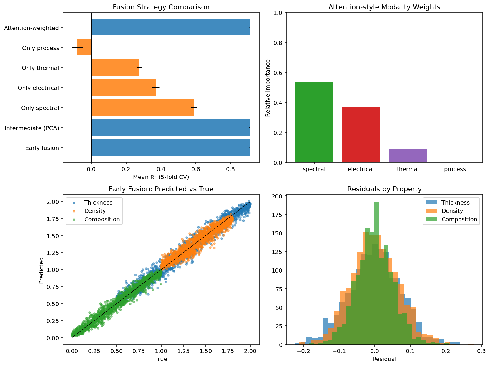

# Multi-Modal Data Fusion

This demo compares different strategies for fusing multi-modal plasma sensor data into a single predictive model. It directly addresses one of the core technical requirements of the SirenOpt Senior Scientist role:

> multi-modal data fusion (combining spectral, imaging, and process data)


---

## Overview

We generate synthetic data with four complementary modalities:

| Modality     | Main Information Carried              | # Features |
|--------------|---------------------------------------|----------|
| Spectral     | Composition + some thickness          | 3        |
| Electrical   | Density + some thickness              | 2        |
| Thermal      | Thickness + density                   | 2        |
| Process      | Power, gas flow, web speed            | 3        |

**Targets** (3 properties):
- Thickness
- Density
- Composition

Each modality is informative for different properties, creating a realistic setting where fusion should outperform any single sensor stream.

---

## Fusion Strategies Compared

| Strategy                  | Description |
|---------------------------|-----------|
| **Early fusion**          | Concatenate all raw features and train one model |
| **Intermediate (PCA)**    | Reduce each modality with PCA, then concatenate |
| **Attention-weighted**    | Scale each modality by its estimated importance, then concatenate |
| **Late fusion**           | Train one model per modality and average predictions |
| **Single-modality baselines** | Models trained on only one sensor type |

All strategies are evaluated with 5-fold cross-validated R² using a multi-output Gradient Boosting model.

---

## Attention-Style Modality Importance

Modality weights are estimated via **permutation importance**:

1. Train a model on all concatenated features and record baseline R².
2. For each modality, randomly shuffle its columns and measure the drop in R².
3. The size of the drop becomes the raw importance of that modality.
4. Normalize the drops so the weights sum to 1.

Typical result:

| Modality    | Relative Importance |
|-------------|---------------------|
| Spectral    | ~0.54               |
| Electrical  | ~0.37               |
| Thermal     | ~0.09               |
| Process     | ~0.00               |

Spectral and electrical signals dominate; process parameters alone contribute almost nothing.

---

## Typical Results

| Strategy              | Mean R² (5-fold CV) |
|-----------------------|---------------------|
| Early fusion          | ≈ 0.90              |
| Intermediate (PCA)    | ≈ 0.90              |
| Attention-weighted    | ≈ 0.90              |
| Only spectral         | ≈ 0.60              |
| Only electrical       | ≈ 0.38              |
| Only thermal          | ≈ 0.28              |
| Only process          | ≈ 0.00              |

**Key finding**: Combining modalities lifts performance from ~0.60 (best single modality) to ~0.90.

---

## How to Run

```bash
python multimodal_fusion.py
